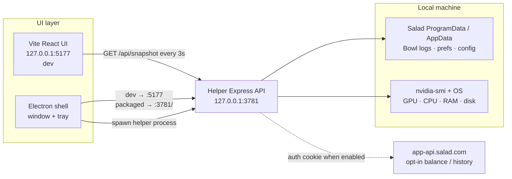
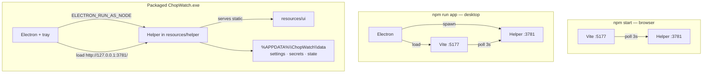
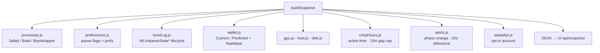
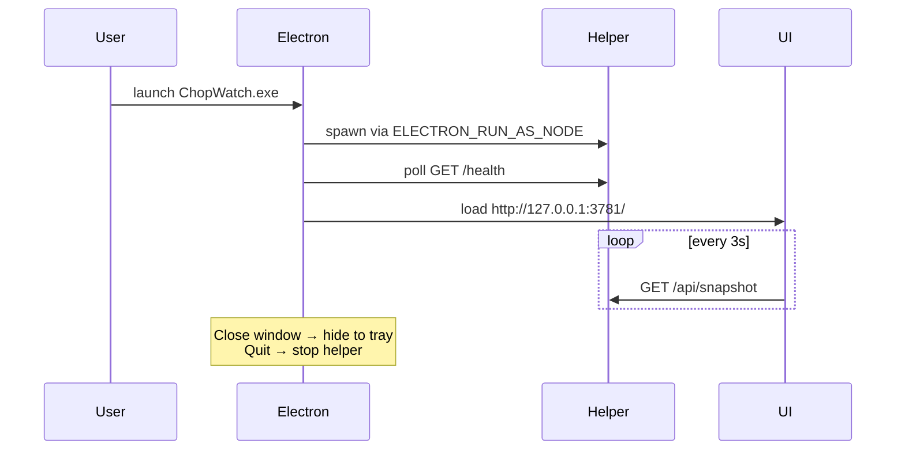
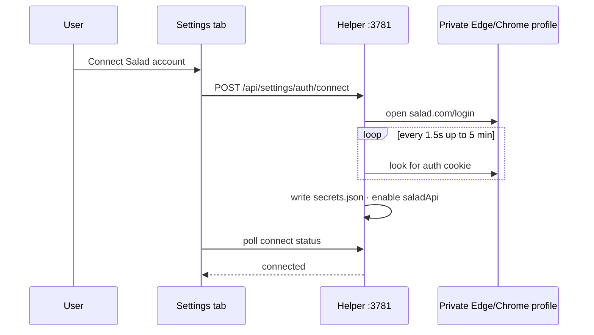
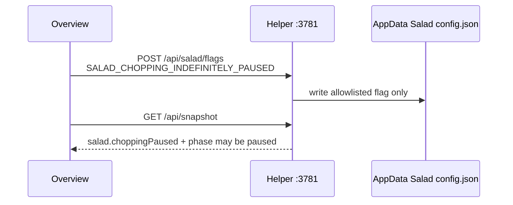
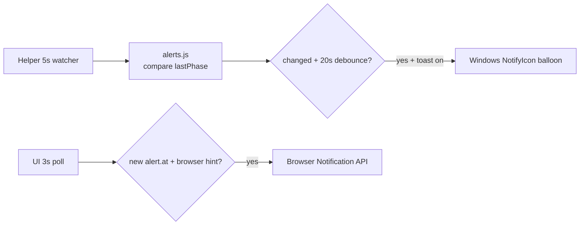
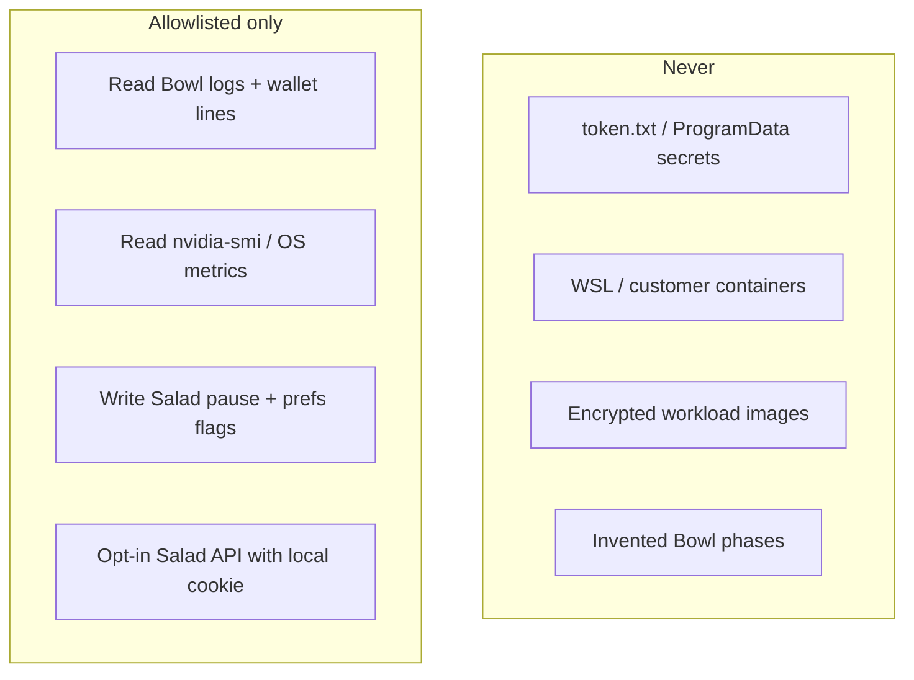
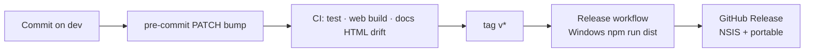

# Architecture

ChopWatch is a local, mostly **read-only** Salad Chopping dashboard: an Express helper, a Vite/React UI, and an optional Electron tray shell. It watches what Salad is *doing* on this PC — lifecycle, GPU/host load, Bowl wallet lines, chopping hours, phase alerts — without opening customer workloads or container filesystems.

**Version:** product version lives in root `package.json` (currently 0.5.x).  
**Repo:** https://github.com/ejw427/ChopWatch · day-to-day `dev` · stable `main`

---

## System overview



| Piece | Role |
| --- | --- |
| `helper/` | Express on `127.0.0.1:3781`. Builds snapshots from Bowl logs, GPU/host, wallet lines, chopping-hour estimates, phase alerts. Optional Salad API. |
| `web/` | Vite + React on `127.0.0.1:5177` in dev. Tabs: Overview, Details, Settings, About. |
| `desktop/` | Electron shell + tray. Dev loads Vite; packaged builds spawn the helper with `ELECTRON_RUN_AS_NODE` and load the UI from the helper (`CHOPWATCH_UI_DIR`). |
| Root | `concurrently` runs helper + web; product version in root `package.json`. `npm run dist` builds Windows installers into `release/`. |

---

## Dev vs packaged topology



### Packaged layout

```text
ChopWatch.exe
resources/
  app.asar          (desktop main + preload)
  helper/           (Express API + production node_modules)
  ui/               (vite build output)
  package.json      (product version)
```

User data (settings, secrets, Connect browser profile) lives under Electron `userData` via `CHOPWATCH_DATA_DIR`, not next to the install.

### Ports & polling

| Loop | Interval | Where |
| --- | --- | --- |
| UI snapshot poll | **3s** | `web/src/App.jsx` → `GET /api/snapshot` |
| Helper phase watcher (toasts with tray-hidden UI) | **5s** | `helper/src/index.js` |
| Connect Salad status poll | **1.5–2s** while waiting | Settings tab |
| Connect cookie sweep | **1.5s**, timeout **5 min** | `saladConnect.js` |
| Salad API cache | **60s** | `saladApi.js` |

---

## Snapshot pipeline

`helper/src/snapshot.js` → `buildSnapshot()` aggregates machine state into one JSON payload for the UI.



| Order | Module | Reads / does |
| --- | --- | --- |
| 1 | `processes.js` | `tasklist` for `Salad*`: Salad, Bowl.Service, Bootstrapper |
| 2 | `preferences.js` | `%APPDATA%\Salad\config.json` flags + ProgramData prefs (allowlisted) |
| 3 | `bowlLog.js` | `%PROGRAMDATA%\Salad\logs` → `WLInstanceState*`, sessions, finding-job inference |
| 4 | `wallet.js` | Bowl `Wallet: Current(...), Predicted(...)` + heartbeat age |
| 5 | `gpu.js` / `host.js` / `disk.js` | nvidia-smi, CPU/RAM, disk (skips `blockedFiles`) |
| 6 | `chopHours.js` | Integrate active samples; **gaps capped 15m** |
| 7 | `alerts.js` | Phase-change debounce **20s**; toast + UI event |
| 8 | `saladApi.js` | Opt-in balance / machines / 30-day history |

### Key Salad paths

| Path | Use |
| --- | --- |
| `C:\ProgramData\Salad\logs` | Bowl lifecycle + wallet lines |
| `C:\ProgramData\Salad\…\preferences.txt` | Workload preference levels (allowlisted writes) |
| `%APPDATA%\Salad\config.json` | Pause / auto-launch / overlay flags (allowlisted writes) |
| `C:\Program Files\Salad` | Install presence only |

---

## Core workflows

### Start (packaged)



### Connect Salad account (opt-in API)



Chrome/Salad lock their cookie DBs while running, so scraping them usually fails. **Connect** opens a private profile under `…/data/salad-browser-profile/`. Manual paste stays under Advanced as fallback.

### Pause / resume chopping



ChopWatch does **not** invent Bowl Running/Pulling — those still come from Salad logs. Allowlisted writes also cover preference levels and a short list of app flags (`SALAD_AUTO_LAUNCH`, overlay, etc.).

### Phase alerts



Alertable phases include `running`, `downloading`, `initializing`, `finding`, `paused`, `offline`, `stopped`.

---

## Safety boundaries

ChopWatch never:

- Reads `token.txt` or other ProgramData credentials by default (`saladPaths.blockedFiles`)
- Opens WSL shells or customer container filesystems
- Inspects encrypted workload images or job payloads
- Fakes Bowl job phases

Optional Salad `auth` cookie lives only in `helper/data/secrets.json` (dev) or `%APPDATA%\ChopWatch\data\secrets.json` (packaged) — gitignored. Treat it like a password.



---

## API surface

| Route | Purpose |
| --- | --- |
| `GET /health` | Ready check for Electron / scripts |
| `GET /api/snapshot` | Full dashboard payload |
| `GET /api/chop-hours` | Chopping-hour series |
| `GET/POST /api/settings` | Alerts / API toggles |
| `POST/DELETE /api/settings/auth/connect` | Connect Salad browser flow |
| `GET /api/salad-account` | Opt-in official account summary |
| `POST /api/salad/flags` · `preferences` · `controls` | Allowlisted Salad writes |

---

## Data on disk

| Path | Contents |
| --- | --- |
| `helper/data/settings.json` (dev) or `%APPDATA%\ChopWatch\data\` (packaged) | Alerts / API toggles |
| `…/secrets.json` | Auth cookie (never commit) |
| `…/runtime-state.json` | Last phase / alert debounce |
| `…/salad-browser-profile/` | Private browser profile for Connect |

---

## Release & quality



| Concern | Mechanism |
| --- | --- |
| Version SoT | Root `package.json`; hook syncs helper/web |
| Tests | Vitest — bowlLog, chopHours, wallet, alerts, logTail, version |
| CI | `main` / `dev`: test → web build → `docs:html` (fail on HTML drift) |
| Packaging | `scripts/pack-desktop.ps1` → `release/` |
| Signing | Off today (`CSC_IDENTITY_AUTO_DISCOVERY=false`); SmartScreen may warn |

Edit `.md` only; regenerate HTML with `npm run docs:html` / `npm run docs:view`.
