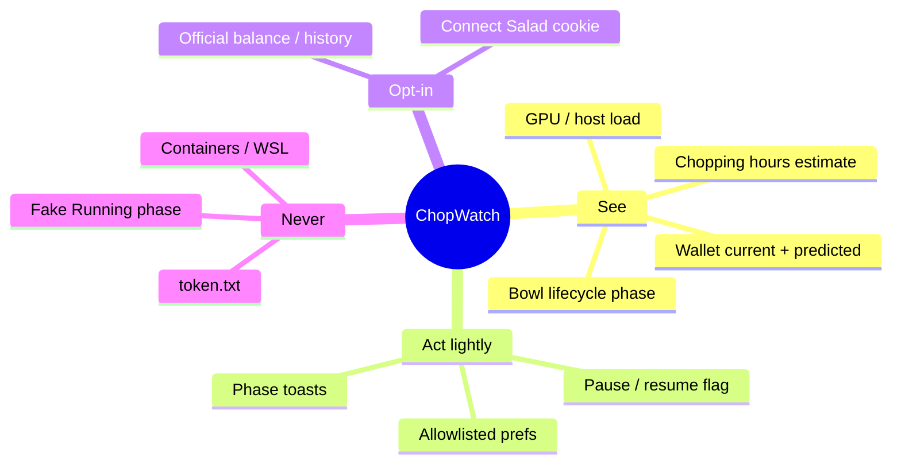
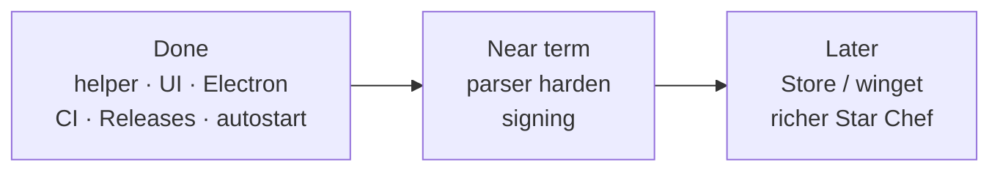
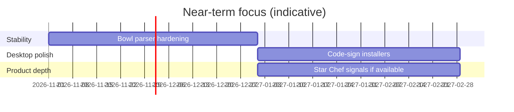
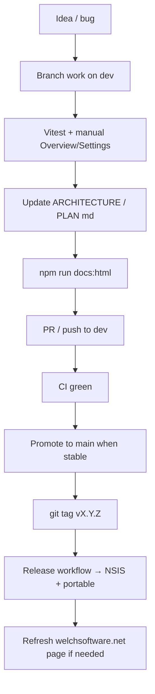
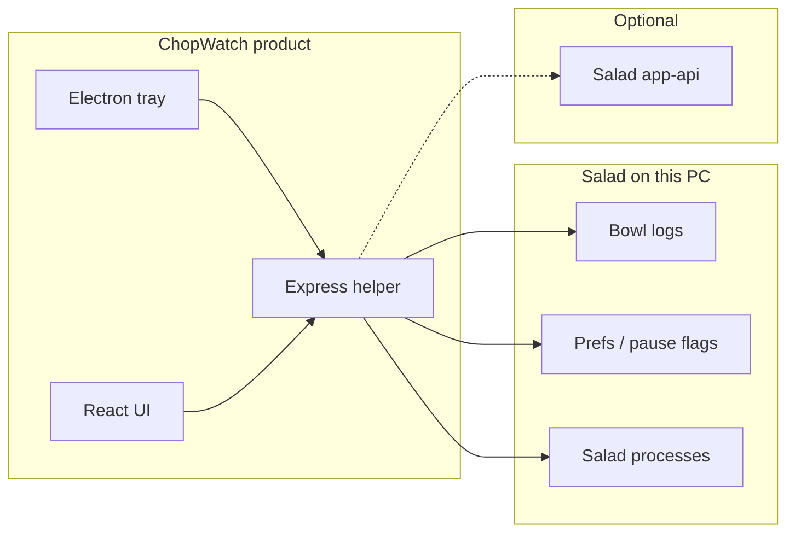

# Project plan

ChopWatch is past the first working dashboard (v0.5.x). This page is the product roadmap: what shipped, what is next, and how work flows from idea → `dev` → release.

---

## Product intent

**Watch Chopping without pretending to see inside the job.**

ChopWatch is a local Salad companion for this PC — lifecycle, GPU/host, Bowl wallet lines, chopping hours, phase alerts, and optional official balance/history. It is not a cloud SaaS, not a workload inspector, and not a substitute for Salad’s own app.

---

## Status at a glance

| Horizon | Themes |
| --- | --- |
| **Done** | Local helper + React tabs, Bowl pipeline, opt-in Salad API, Electron tray, Start with Windows, Vitest/CI, Windows NSIS + portable on GitHub Releases |
| **Near term** | Parser hardening, code-signing, richer Star Chef signals if Salad exposes them |
| **Later** | winget / Microsoft Store, promote-`dev`-to-`main` script; keep welchsoftware.net ChopWatch page + `/chopwatch/` docs current |

---

## Done

- Local helper + React UI (Overview / Details / Settings / About)
- Bowl lifecycle parsing, wallet lines, GPU/host, chopping hours, phase alerts
- Opt-in Salad API + Connect Salad browser capture
- Allowlisted pause/resume and preference edits from Overview
- GitHub repo hygiene: version bump hooks, docs + HTML sisters, Vitest, CI
- Windows packaging (`npm run dist`) + GitHub Releases workflow
- Electron tray shell (hide-on-close; Quit stops helper)
- Start with Windows (packaged app; tray login start via --hidden)
- Public product page + Mermaid docs hub on welchsoftware.net

---

## Near term

| Item | Why |
| --- | --- |
| Harden Bowl parsers | Salad log formats change; keep phases honest |
| Code-sign installers | Calm SmartScreen / Chrome warnings |
| Richer Star Chef / reward progress | Only if Salad exposes clearer local or API signals |

---

## Later (optional)

- Promote `dev` → `main` release script (DropToPhone-style)
- winget / Microsoft Store once releases and signing are steady
- Richer public download landing if Store distribution is delayed

Marketing page + architecture/plan HTML hub: [welchsoftware.net/projects/chopwatch](https://www.welchsoftware.net/projects/chopwatch) · [/chopwatch/](https://www.welchsoftware.net/chopwatch/)

---

## Delivery workflow

Day-to-day work stays on **`dev`**. Promote to **`main`** for a stable line. Tags `v*` cut Windows artifacts via GitHub Actions.

### Versioning

- Root `package.json` is the source of truth
- Pre-commit hook bumps **PATCH** and syncs `helper/` + `web/`
- Major/minor change by hand for milestones
- See [TESTING.md](TESTING.md)

### Docs

| Doc | Purpose |
| --- | --- |
| [ARCHITECTURE.md](ARCHITECTURE.md) | Processes, snapshot pipeline, workflows, safety |
| [PROJECT_PLAN.md](PROJECT_PLAN.md) | This roadmap |
| [PRIVACY_POLICY.md](PRIVACY_POLICY.md) | What we read / never read |
| [TESTING.md](TESTING.md) | Versions, HTML sisters, Vitest |

Regenerate HTML: `npm run docs:html` · open: `npm run docs:view`

---

## Architecture snapshot (for planning)

Full detail lives in [ARCHITECTURE.md](ARCHITECTURE.md). Planning view:

**Non-goals for the current milestone**

- Cloud sync or multi-PC fleet dashboard
- Reading customer container filesystems
- Replacing Salad’s own chef UI
- Unsigned Store distribution before signing is in place

---

## Success checks

A release is “good enough” when:

1. Packaged app starts, tray works, helper answers `/health`
2. Overview shows a believable phase while Salad is chopping / paused / idle
3. Pause/resume flips Salad’s indefinite-pause flag and the next snapshot reflects it
4. Connect Salad (or Advanced paste) can populate balance when opted in
5. `npm test` and CI docs HTML check stay green
6. GitHub Release publishes both NSIS and portable builds

---

## Branches

| Branch | Role |
| --- | --- |
| `dev` | Day-to-day work |
| `main` | Stable line |
| `v*` tags | Windows release artifacts |
